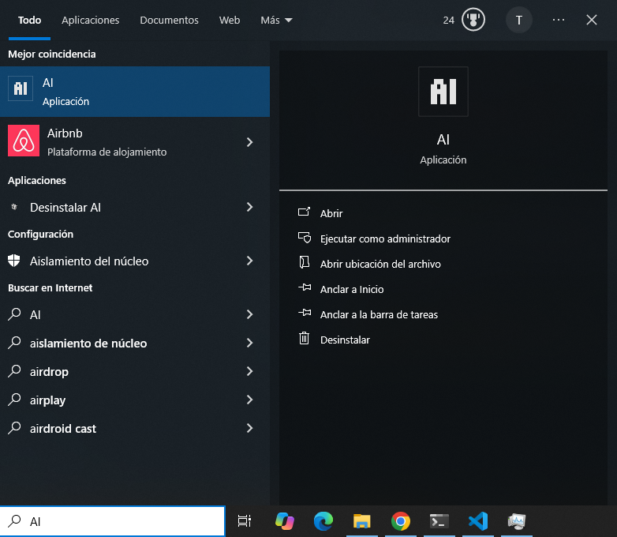
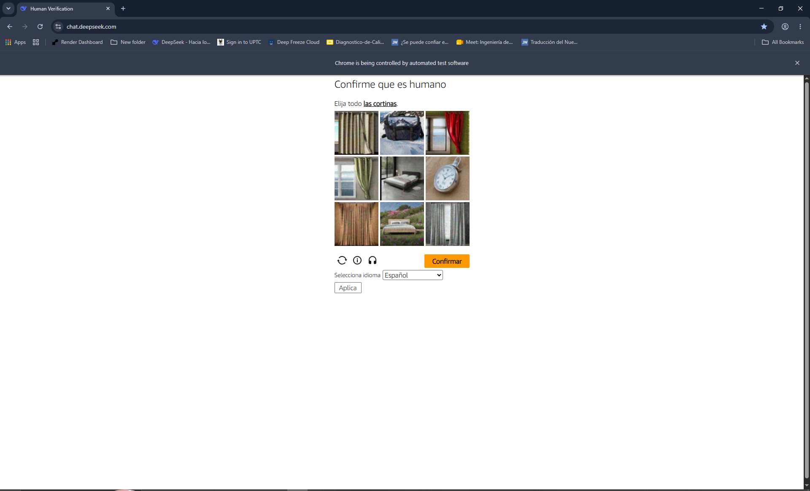
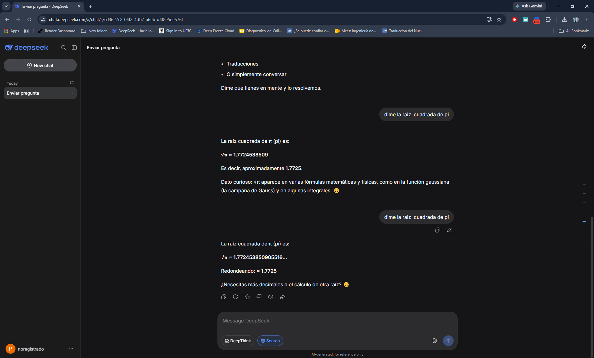
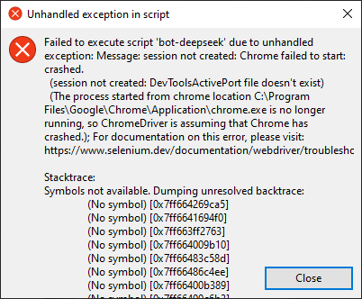

# Herramienta de uso de DeepSeek

Esta herramienta hecha en python busca poder usar DeepSeek de manera mas facil y sencilla. Para esto se hace uso de combinaciones de teclas y atajos de teclado.

## Atajos de teclado

* **Ctrl + < :** Ocultar/Mostrar la ventana del navegador web.
* **Ctrl + Y :** Copiar y mostrar la ultima respuesta del chat de deepseek.
* **Alt Gr + M :** Pegar el texto del portapapeles al chat de deepseek y enviarlo.
* **Alt Gr + , :** Terminar el proceso.

## Instalador

Se puede instalar la app con el [instalador](https://github.com/XXVECTOR000XX/bot-deepseek/releases/download/1.0/Instalador_AI.exe) en [releases](https://github.com/XXVECTOR000XX/bot-deepseek/releases).

## Ejecucion con python

```powershell
python bot-deepseek.py
```

## Creacion del ejecutable con pyinstaller

Para compilar bot-deepseek, a un ejecutable, es necesario ejecutar el siguiente comando con pyinstaller.

```bash
pyinstaller.exe .\bot-deepseek.py --icon .\icon.ico --noconsole --onefile --collect-submodules=selenium
```

El [icono](icon.ico) se encuentra en el repositorio.

## Proceso de uso del programa

Una vez instalado el programa, se puede usar desde el menu, escribiendo "AI" en el buscador. Esto abrira una ventana de chrome, que es un bot web.



Al momento de abrir deepseek e intentar loguearse pueden aparecer varias pruebas humanas.



Lo recomendable es copiar la carpeta de datos de usuario del propio chrome a la carpeta "perfil_deepseek" en la carpeta de instalacion del programa. Esto para saltarse los recaptchas, ya que estos son irresolubles.

Una vez entrado a deepseek, simplemente se escoje cualquier chat del sitio web.



Ya entrado en el chat, se podran usar los hotkeys o atajos de teclado.

## Problemas frecuentes

* **Recaptcha infinito o imposible:** Debido a que el programa usa un bot web, ciertas paginas como deepseek o chatgpt, tienen restringidos el uso de estos medios para usar sus paginas, por lo que para inicar sesion pediran resolver captchas que no tiene solucion. Para solventar esto, es necesario copiar el perfil comun de chrome a la carpeta de instalacion del programa, para poder usar este bot sin problemas.

```powershell
cp "$home\AppData\Local\Google\Chrome\User Data\*" "$home\AppData\Local\AI\perfil_navegador\" -Recurse -Force
```

Ejecutar este comando sin tener chrome abierto.

* **Chrome abierto:** Este error es debido a que algun proceso de chrome o que el propio programa no se ha cerrado correctamente.



Simplemente se deben cerrar los procesos de chrome o de bot-deepseek.exe abiertos desde el administrador de tareas.